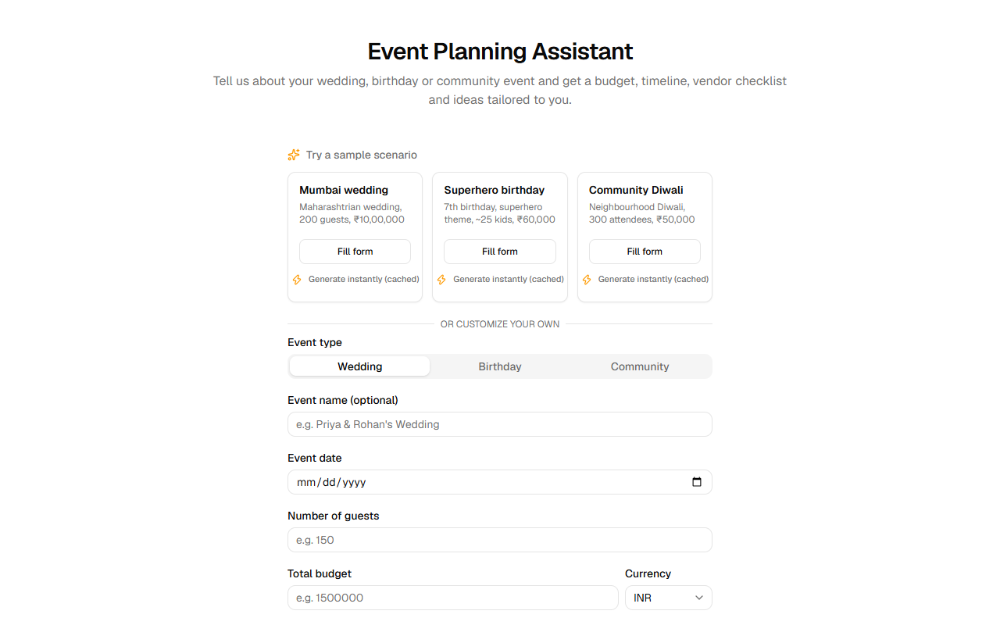
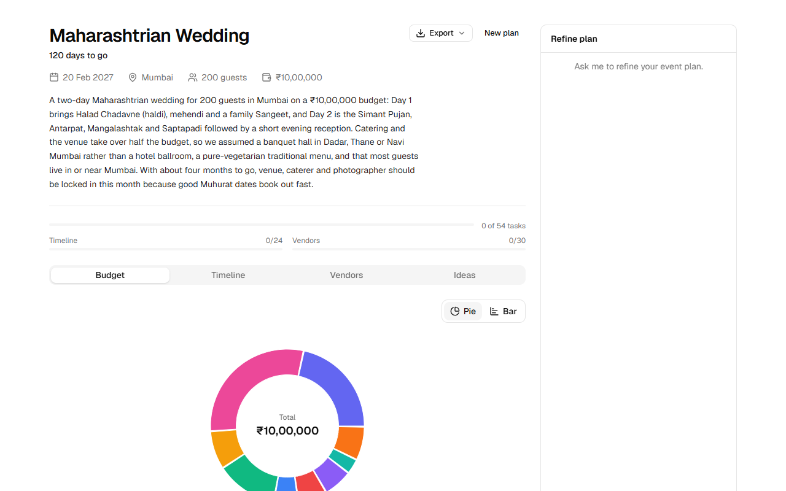
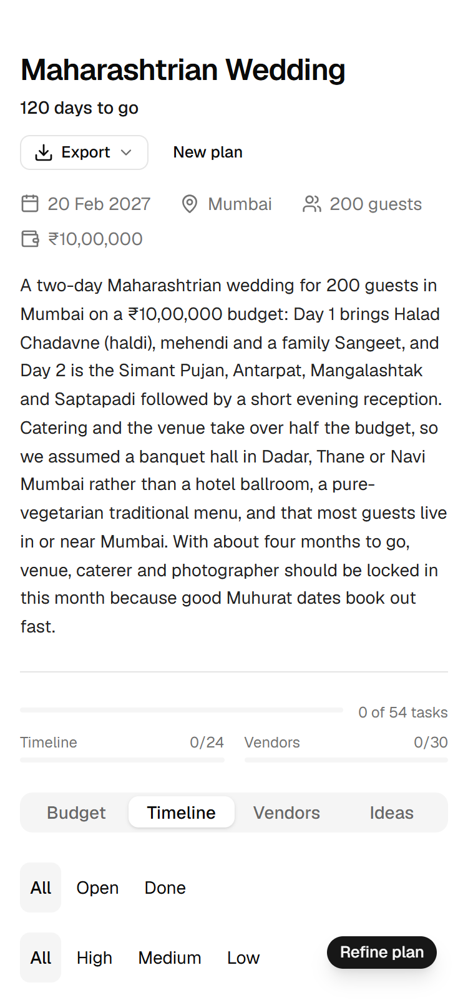
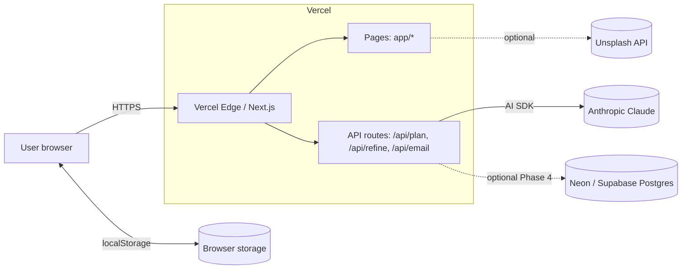
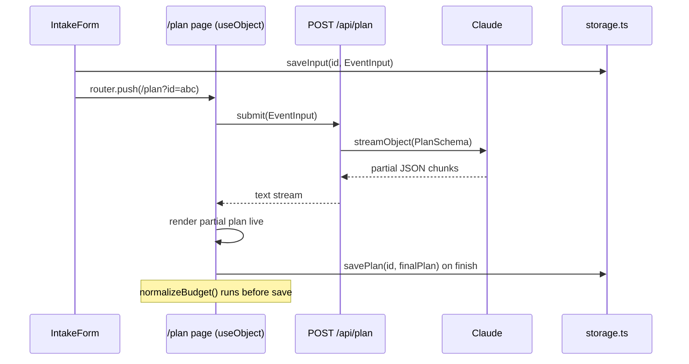

# EventAI - Event Planning Assistant

An AI event planner for **weddings, birthdays and community events**. You tell it the event type, city, guest count, budget and any cultural traditions, and it streams back a plan built around *those* inputs: a budget split, a dated timeline, a vendor checklist and theme/decor ideas. You can then refine the plan by chatting with it ("cut the budget by 20%").

**Public URL:** https://eventai-delta.vercel.app/

## The pitch: personalisation first

This is not a generic checklist generator. The plan changes with who you are and where you are:

- **Culture** - a Maharashtrian two-day wedding gets Halad, Sangeet, Simant Pujan and Muhurat-date advice; a Diwali community event gets different priorities.
- **Budget** - the allocation is normalised so percentages sum to 100 and the amounts add up to the exact budget you entered. Refining the budget updates the chart live.
- **Guest count** - catering, venue size and vendor choices scale with headcount (25 kids vs 200 vs 300 attendees).
- **Location** - vendors, venue types and logistics are suited to the city you enter.

Everything is rendered as real UI (chart, timeline with checkboxes, vendor accordion, idea cards), not raw text. Progress is saved and survives a refresh.

## Demo

▶ **[Watch the demo (MP4)](docs/screenshots/demo.mp4)** — cached scenario load → streaming plan → "cut the budget by 20%" → chart updates → Undo

## Screenshots

Captured from a production build (`pnpm build` + `pnpm start`) using the cached Mumbai wedding fixture.

| Landing | Plan dashboard (desktop) | Plan (375 px mobile) |
|---|---|---|
|  |  |  |

## Features

- Intake form with validation, plus three one-click demo scenarios
- Streaming plan generation (partial results render as they arrive)
- Budget donut/bar chart, filterable timeline, vendor checklist, ideas and mood board
- Refine chat with **Undo** for the last change
- Vendor enquiry email drafts
- Export: calendar (`.ics`) and print-to-PDF
- Checklist progress persisted in the browser
- Cached fallback plans so the demo works with no API or network

## Setup

Prerequisites: **Node.js 20.9+** (required by Next.js 16) and **pnpm** (the repo pins `pnpm@12.14.0` via `packageManager`; with Corepack enabled this is picked up automatically).

```bash
git clone <repo-url> eventai
cd eventai
pnpm i
cp .env.example .env.local     # PowerShell: Copy-Item .env.example .env.local
# edit .env.local and set ANTHROPIC_API_KEY
pnpm dev
```

Open <http://localhost:3000>.

No API key yet? Set `NEXT_PUBLIC_DEMO_FALLBACK=true` in `.env.local` (or visit any plan URL with `?demo=1`). The three demo scenarios then replay cached plans with no LLM call. Custom inputs still need a key.

## Environment variables

Copy `.env.example` to `.env.local`. Next.js loads it automatically; restart `pnpm dev` after changing it.

| Variable | Scope | Required | Default | Purpose |
|---|---|---|---|---|
| `ANTHROPIC_API_KEY` | Server only | **Yes** for live generation, refine and email (not needed for the cached demo path) | none | Anthropic API key, read by `@ai-sdk/anthropic`. |
| `ANTHROPIC_BASE_URL` | Server only | No | `https://api.anthropic.com/v1` | Point at an LLM gateway/proxy. Read by `@ai-sdk/anthropic`; must include the `/v1` suffix. |
| `LLM_MODEL` | Server only | No | `claude-sonnet-4-5` | Model id, read in `lib/ai.ts`. |
| `NEXT_PUBLIC_DEMO_FALLBACK` | **Public** (inlined into the client bundle) | No | `false` | When `"true"`, the plan page replays the cached fixture for the three demo scenarios instead of calling the API. Same as `?demo=1` per visit. |
| `UNSPLASH_ACCESS_KEY` | Server only | No | none | Enables mood-board photos via `/api/moodboard`. Without it the route returns an empty list and the mood board section is simply hidden. |
| `DATABASE_URL` | Server only | No | none | Listed in `.env.example` and the specs as a Phase 4 placeholder, but **no code reads it today**. Storage is browser `localStorage` only. |

Rules of thumb: never prefix a secret with `NEXT_PUBLIC_`; only `NEXT_PUBLIC_*` values can reach the browser. See the [security checklist](#security-checklist-code-review) below.

## Scripts

All scripts are defined in [`package.json`](package.json).

| Command | What it does |
|---|---|
| `pnpm dev` | Start the Next.js dev server on port 3000. |
| `pnpm build` | Production build. |
| `pnpm start` | Serve the production build (run `pnpm build` first). |
| `pnpm lint` | ESLint. |
| `pnpm typecheck` | `tsc --noEmit`. |
| `pnpm test` | Run the Vitest suite once. |
| `pnpm test:watch` | Vitest in watch mode. |

Full pre-demo check: `pnpm lint && pnpm typecheck && pnpm test && pnpm build`.

## Demo scenarios

Defined in [`lib/demo.ts`](lib/demo.ts). Dates are computed relative to today, so a demo never contains a past date. Each card on the landing page has two buttons:

- **Fill form** - pre-fills the intake form so you can tweak it and submit (this calls the live API).
- **Generate instantly (cached)** - creates the plan and opens it with `?demo=1`, which replays the committed fixture from `lib/fixtures/<id>.json` through a fake stream. No LLM call; the plan still visibly streams in.

| Scenario id | Card label | Input |
|---|---|---|
| `wedding-mumbai` | Mumbai wedding | Maharashtrian two-day wedding, Mumbai, 200 guests, INR 10,00,000, date = today + 120 days |
| `birthday-superhero` | Superhero birthday | 7th birthday, superhero theme, ~25 kids, Pune, INR 60,000, date = today + 30 days |
| `community-diwali` | Community Diwali | Neighbourhood Diwali, 300 attendees, Pune, INR 50,000, date = today + 45 days |

Replay and the "Use sample plan" button after a failed generation only apply when the input matches a scenario on event type, city, guest count and budget (the date is ignored).

## Architecture

Pages and thin API routes live in `app/`, UI in `components/`, and all business logic as pure functions in `lib/` (schema, prompts, dates, budget, storage, export, refine). API routes: `/api/plan`, `/api/refine`, `/api/email` (LLM, `maxDuration = 60`) and `/api/moodboard` (Unsplash proxy).



*Context diagram from [TECHNICAL_DESIGN §3.1](specs/TECHNICAL_DESIGN.md). The Postgres link is the optional Phase 4 idea and is not implemented; the Unsplash call goes through `/api/moodboard`.*



*Runtime data flow from [TECHNICAL_DESIGN §3.2](specs/TECHNICAL_DESIGN.md). In the code the plan is saved to storage and the user is routed to `/plan/<id>`, rather than `/plan?id=abc`.*

## Demo script

Suggested order for judging (matches the Demo-day checklist in [`specs/tasks/phase-5-demo-prep.md`](specs/tasks/phase-5-demo-prep.md)):

1. **Before you start:** clean `localStorage` (or a pre-ticked plan ready to show persistence), Anthropic key has credit and a spend limit, and `?demo=1` was verified an hour earlier.
2. **Pitch the personalisation** (culture, budget, guests, location), not "a checklist generator".
3. **Pick a scenario**, in order: Mumbai wedding, then Superhero birthday, then Community Diwali. Use **Fill form** + submit for a live LLM run, or **Generate instantly (cached)** for a guaranteed one.
4. **Show streaming** - the summary, budget and timeline fill in progressively.
5. **Tick items** in the timeline/vendors; the progress bars update (refresh to show it persists).
6. **Live refine:** open the chat ("Refine plan" button on mobile) and type **"cut the budget by 20%"**. Watch the chart and amounts update.
7. **Undo** the change from the assistant message.
8. **Export calendar** from the Export menu (`.ics`).

Fallback if the API or network fails: the dashboard offers **Use sample plan** for demo-scenario inputs. To force cached mode, append `?demo=1` to the plan URL or deploy with `NEXT_PUBLIC_DEMO_FALLBACK=true` (it is inlined at build time, so redeploy after changing it).

## Rate limiting & cost protection

Each API route enforces an **in-memory sliding-window rate limit** per client IP:

| Route | Limit |
|---|---|
| `POST /api/plan` | 5 requests per 10 minutes |
| `POST /api/refine` | 20 requests per 10 minutes |
| `POST /api/email` | 20 requests per 10 minutes |

Exceeding the limit returns HTTP 429 with a `Retry-After` header. The UI shows a toast with the wait time.

**Important limitations:**

- The limiter is **in-memory only** and does not share state across Vercel serverless function instances. On a multi-instance deployment, each instance enforces its own independent bucket, so the effective limit is per-instance, not global. This is best-effort protection for demo/low-traffic use.
- For hard global cost protection, **manually set a monthly spend limit** in the [Anthropic console](https://console.anthropic.com/) (Account → Billing → Spend limits). This is the only reliable safeguard against runaway LLM costs.
- The demo/replay fallback path (`?demo=1` or `NEXT_PUBLIC_DEMO_FALLBACK=true`) makes no LLM calls and is unaffected by rate limiting.

LLM output token caps per call: `plan` 4 000, `refine` 4 500, `email` 600.

## Security checklist (code-review)

- **No `dangerouslySetInnerHTML`** - all LLM text is rendered as plain React text nodes; run `grep -r dangerouslySetInnerHTML app components lib` to verify.
- **No logging of free text or keys** - server logs must contain only enumerated, non-sensitive fields (route, eventType, latencyMs, tokens, ok). Never log user input, plan content, or env var values.
- **Server-only env vars** - `ANTHROPIC_API_KEY`, `LLM_MODEL`, `DATABASE_URL`, `UNSPLASH_ACCESS_KEY` must never appear in client components or files without a `server-only` guard. Only `NEXT_PUBLIC_*` vars are safe to read on the client.
- **Bundle inspection** - after `pnpm build`, `grep -r sk-ant .next/static` must return nothing.
- **Security headers** - `X-Content-Type-Options`, `Referrer-Policy`, `X-Frame-Options`, and `Permissions-Policy` are applied to all routes via `next.config.ts`.

## Known limitations

- **In-memory rate limiter** - best-effort and per Vercel instance, not global (see above). Set an Anthropic spend limit.
- **Local-only storage** - plans, progress and chat live in the browser's `localStorage`. There are no accounts and no sync across devices or browsers; clearing site data deletes everything. Some private-browsing modes cannot persist data (the app shows a toast).
- **AI-generated cultural content may be inaccurate** - rituals, customs, vendor types and cost estimates come from an LLM. Treat them as a starting point and verify with family, priests/officiants and real vendor quotes. Vendor suggestions are AI-generated, not verified businesses.
- **No authentication** - anyone with the URL can use the app and spend LLM quota (mitigated only by the rate limiter and spend limit).
- **Fixtures are hand-authored** - the cached plans in `lib/fixtures/` are committed sample data (validated against `PlanSchema` in tests), not live output, and only match the exact demo-scenario inputs.
- **No database** - `DATABASE_URL` is reserved for a future phase and is currently unused.

## Specs and task docs

- [`specs/PROJECT_SPEC.md`](specs/PROJECT_SPEC.md) - product spec and acceptance criteria (§12 demo tips, §13 acceptance)
- [`specs/TECHNICAL_DESIGN.md`](specs/TECHNICAL_DESIGN.md) - technical design (§3 diagrams, §12 demo readiness)
- [`specs/tasks/README.md`](specs/tasks/README.md) - task index, with per-phase files:
  [Phase 1](specs/tasks/phase-1-scaffold.md) ·
  [Phase 2](specs/tasks/phase-2-dashboard.md) ·
  [Phase 3](specs/tasks/phase-3-interactivity.md) ·
  [Phase 4](specs/tasks/phase-4-polish.md) ·
  [Phase 5](specs/tasks/phase-5-demo-prep.md)

## Deploying

Deploy on Vercel: import the repo and set `ANTHROPIC_API_KEY` (plus optional `LLM_MODEL`, `NEXT_PUBLIC_DEMO_FALLBACK`, `UNSPLASH_ACCESS_KEY`). The three LLM routes set `maxDuration = 60`. Public URL: https://eventai-delta.vercel.app/
